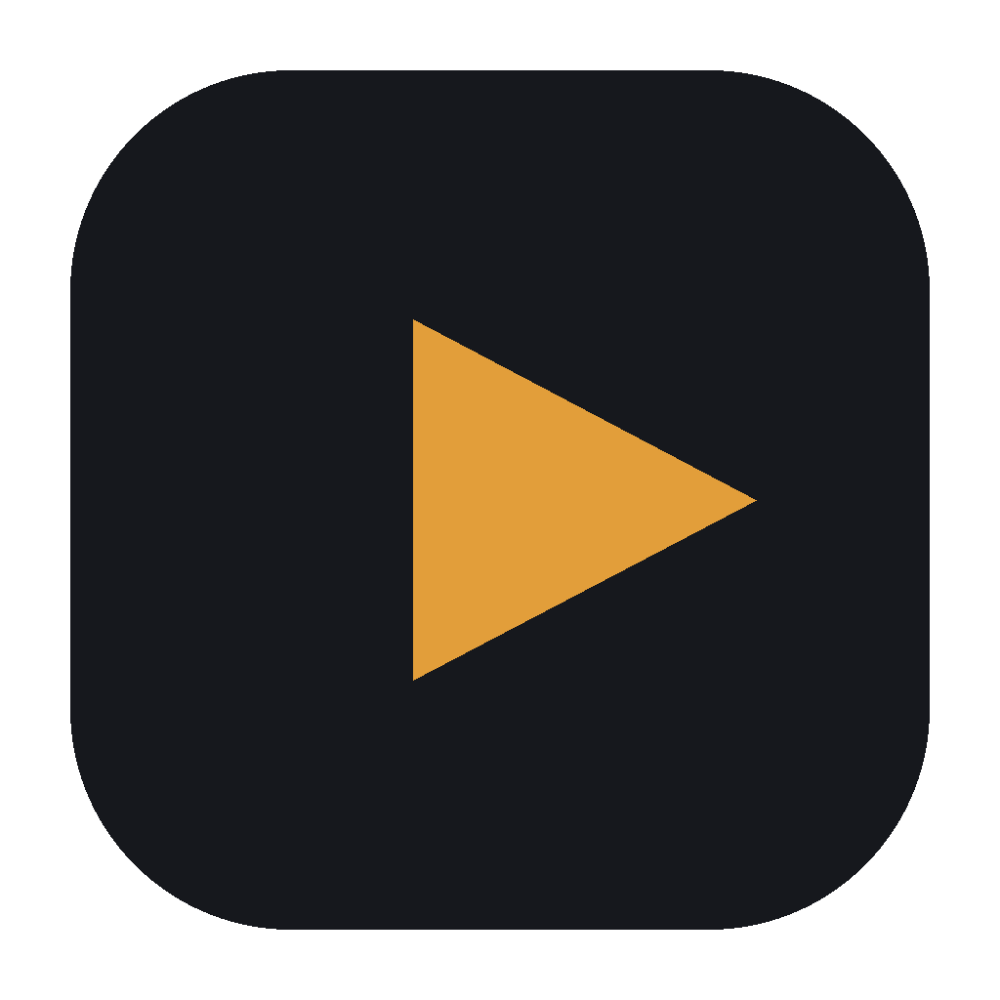
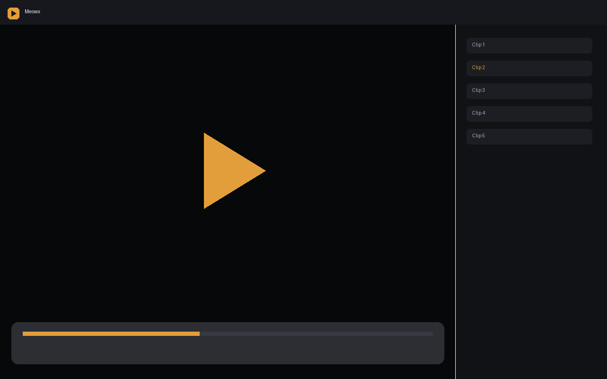

# Meowx

Free open source media player for macOS. It plays local files and network streams through libmpv, with VideoToolbox hardware decoding on Apple Silicon.





This repository is the Xcode project. It is not a prebuilt application. Build it on an Apple Silicon Mac, or install a signed release with one of the methods below after a GitHub release exists.

## Features

- Plays the formats libmpv and FFmpeg support, including MKV, MP4, MOV, AVI, WebM, FLAC, MP3, and HLS
- H.264, HEVC, VP9, AV1, and 10-bit video, with HDR tone mapping and VideoToolbox when it is available
- Frame-accurate seek, frame step, 0.25×–4× speed with pitch correction, A-B loop, repeat, and shuffle
- Resume position per file in `~/Library/Application Support/Meowx/`
- Subtitles (SRT, ASS/SSA, VTT, and embedded tracks), delays, font, size, color, and position
- Multiple audio tracks
- Open HTTP, HTTPS, HLS, RTSP, and RTMP addresses
- yt-dlp for site links when you install it yourself (it is not bundled)
- Playlist sidebar, reorder, and save as `.m3u`
- Full screen, always on top, and a floating picture-in-picture panel
- Seek-bar thumbnail preview
- Volume to 200% and mute
- Menu commands and keyboard shortcuts
- Touch Bar and media keys through Now Playing
- Stats overlay (decoder, resolution, fps, dropped frames, bitrate, cache)
- Screenshot to PNG or JPEG
- Light and dark mode follow the system

## Requirements

- Apple Silicon Mac (M1 or newer)
- macOS 26 or newer
- Intel Macs are not supported

Streaming smoothness depends on your connection. Local files should play without the player adding delay of its own. The app is not notarized.

## Install

### DMG

1. Download `Meowx-<version>.dmg` from [GitHub Releases](https://github.com/Cappy7/Meowx/releases).
2. Open it and drag Meowx into Applications.
3. The first launch is blocked because the app is not notarized. Open it once, then go to **System Settings > Privacy & Security**, scroll down, and click **Open Anyway** next to Meowx. Right-click > Open does not clear this warning on current macOS.
4. Or run this once in Terminal:

```bash
xattr -dr com.apple.quarantine /Applications/Meowx.app
```

### Homebrew

The cask lives in [Cappy7/homebrew-meowx](https://github.com/Cappy7/homebrew-meowx). A copy of `Casks/meowx.rb` is in `homebrew-meowx/` in this repository so you can publish that tap.

```bash
brew install --cask cappy7/meowx/meowx
```

The cask removes the quarantine flag, so Homebrew installs do not show the unidentified-developer warning.

### One-line script

```bash
curl -fsSL https://raw.githubusercontent.com/Cappy7/Meowx/main/scripts/install.sh | bash
```

The script checks that the Mac is Apple Silicon and that macOS is 26 or newer, then downloads the latest release, copies it to `/Applications`, and clears quarantine.

## Make Meowx the default player

Meowx registers as a viewer for video and audio types. It does not take ownership of Apple's system types by itself.

Choose **Video > Set as Default Player**. macOS has to accept the change. If it refuses, Meowx shows the error instead of claiming success. You can also select a file in Finder, choose **Get Info**, set **Open with** to Meowx, and click **Change All**.


## Keyboard shortcuts

These rows are the same list the app uses for keys, tooltips, and Help > Keyboard Shortcuts. Bare keys are handled by the player only when you are not typing in a text field or a sheet. Command shortcuts stay on the menu.

| Key | Action |
| --- | --- |
| Space | Play or pause |
| Cmd+Left | Previous |
| Cmd+Right | Next |
| Left | Seek back 5 seconds |
| Right | Seek forward 5 seconds |
| Shift+Left | Seek back 30 seconds |
| Shift+Right | Seek forward 30 seconds |
| 0 | Jump to 0% |
| 1 | Jump to 10% |
| 2 | Jump to 20% |
| 3 | Jump to 30% |
| 4 | Jump to 40% |
| 5 | Jump to 50% |
| 6 | Jump to 60% |
| 7 | Jump to 70% |
| 8 | Jump to 80% |
| 9 | Jump to 90% |
| Home | Go to start |
| End | Go to end |
| Up | Volume up |
| Down | Volume down |
| Shift+Up | Volume up 10 |
| Shift+Down | Volume down 10 |
| M | Mute |
| A | Audio tracks |
| Shift+A | Previous audio track |
| Opt+Z | Audio delay earlier |
| Opt+X | Audio delay later |
| S | Subtitles |
| Shift+S | Previous subtitle |
| V | Show or hide subtitles |
| Z | Subtitle delay earlier |
| X | Subtitle delay later |
| [ | Speed down |
| ] | Speed up |
| \ | Reset speed |
| , | Previous frame |
| . | Next frame |
| Cmd+J | Go to time |
| L | Loop A, then B, then clear |
| Shift+L | Loop current file |
| Shift+Cmd+S | Screenshot |
| R | Rotate 90 degrees |
| E | Cycle aspect ratio |
| F | Full screen |
| Ctrl+Cmd+F | Full screen |
| Esc | Leave full screen |
| P | Picture in Picture |
| Cmd+T | Always on top |
| Cmd+1 | Window 50% |
| Cmd+2 | Window 100% |
| Cmd+3 | Window 200% |
| Cmd+0 | Fit window to screen |
| I | Stats |
| Cmd+O | Open |
| Cmd+U | Open URL |
| Shift+Cmd+O | Add to playlist |

## Supported formats

Containers include MKV, MP4, M4V, MOV, AVI, WMV, FLV, WebM, TS, M2TS, MPG, OGV, 3GP, RMVB, VOB, and ISO or `VIDEO_TS` folders. Audio includes MP3, FLAC, AAC, M4A, OGG, Opus, WAV, WMA, ALAC, AC3, and DTS. Codecs include H.264, HEVC/H.265, VP9, AV1, MPEG-2, and ProRes. Subtitles include SRT, ASS/SSA, VTT, SUB, PGS, and embedded tracks. Anything else libmpv can open will usually open too.

## Build from source

You need Xcode with the macOS 26 SDK, and libmpv from Homebrew. The app links libmpv while you develop. A release build copies the libraries inside the app so a Mac without Homebrew can still run it.

```bash
git clone https://github.com/Cappy7/Meowx.git
cd Meowx
brew install mpv
open Meowx.xcodeproj
```

Press Run. The first build checks that `/opt/homebrew/include/mpv/client.h` exists.

Unit tests do not need the player UI:

```bash
swift test --package-path Packages/MeowxCore
```

To make a portable app and a disk image:

```bash
brew install mpv dylibbundler create-dmg
xcodebuild -project Meowx.xcodeproj -scheme Meowx -configuration Release -destination 'platform=macOS,arch=arm64' -derivedDataPath build/DerivedData ARCHS=arm64 ONLY_ACTIVE_ARCH=NO CODE_SIGN_IDENTITY=- build
APP="$(find build/DerivedData -name Meowx.app -type d | head -1)"
scripts/bundle_libs.sh "$APP"
scripts/build_dmg.sh "$APP" 1.0.0
```

`scripts/bundle_libs.sh` ad-hoc signs every bundled library and then the app. An unsigned arm64 app will not launch.

If you want YouTube and similar links, install `yt-dlp` yourself. The Xcode build copies mpv's `ytdl_hook.lua` into the app when it can find it. Meowx does not bundle yt-dlp.

## Notes

- Hardware decoding uses `hwdec=videotoolbox` and falls back to software if VideoToolbox cannot decode the file. The stats overlay shows the active decoder. Press I.
- Video is drawn with libmpv's OpenGL render API into a `CAOpenGLLayer`. libmpv does not offer a Metal render backend.
- Dolby Vision uses the base layer. The enhancement layer is not a separate path.
- Online subtitle search uses your own OpenSubtitles API key, stored only in preferences on this Mac.
- Cache size and the large stream readahead are there to reduce stalls. They cannot make a slow connection instant.
- The picture-in-picture control is a floating player panel. It is not the system video PiP used by the TV app, because that path does not take an OpenGL surface.

## License

[GPL-3.0](LICENSE). Meowx links GPL builds of libmpv and FFmpeg, so the app is GPL-3.0 too. See [THIRD_PARTY_NOTICES.txt](THIRD_PARTY_NOTICES.txt) for mpv, FFmpeg, libass, and the other libraries copied into a release build.

Do not copy source, names, logos, or icons from VLC, IINA, or other players. Talk to libmpv only through its public headers.
